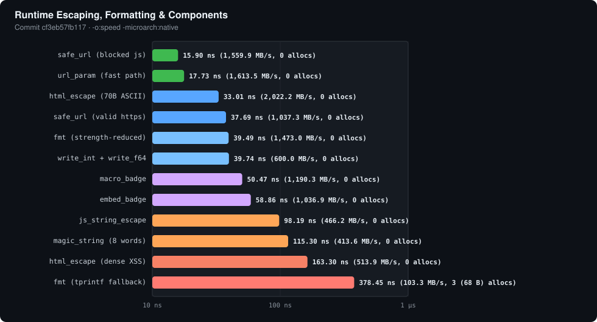
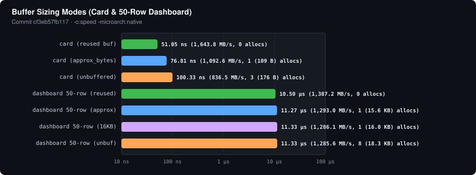
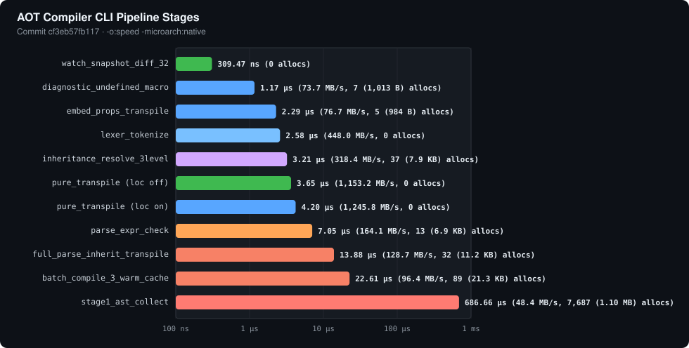

# Runa Benchmarks & Optimization Architecture

This directory contains the benchmark suite for **Runa**, measuring both **runtime rendering & context-aware escaping** (`runtime.odin`) and the **3-stage CLI compiler pipeline** (`cli/`).

---

## Running the Benchmarks

Run and record the benchmark suite via [`hugi`](../../hugi/README.md) (`-o:speed` is applied automatically):

```sh
# Optional: regenerate benchmarks/templates_gen.odin and verify no unused templates exist
odin run cli -- --warn-unused benchmarks -out:benchmarks/templates_gen.odin -pkg:benchmarks -runa-import:..

# Verify generated benchmark templates are up-to-date (used in CI)
odin run cli -- --check --warn-unused benchmarks -out:benchmarks/templates_gen.odin -pkg:benchmarks -runa-import:..

# Run the benchmark suite and ingest results into benchmarks/history.hugidb
hugi run benchmarks

# Compare the latest commit against the previous commit
hugi compare --last

# Optional: regenerate or verify the AOT report templates in tools/bench_report
odin run cli -- --warn-unused tools/bench_report -out:tools/bench_report/templates_gen.odin -pkg:bench_report -runa-import:../..
odin run cli -- --check --warn-unused tools/bench_report -out:tools/bench_report/templates_gen.odin -pkg:bench_report -runa-import:../..

# Regenerate both README.md and benchmarks/README.md tables from benchmarks/history.hugidb
odin run tools/bench_report
```

### Harness Methodology (`benchmarks/main.odin`)

* **Calibrated Timing & Untimed Allocation Checks (`hugi` / `obench`):** Hot loops execute in calibrated timed batches without allocation-counter overhead (`untimed_alloc_check = true` + vDSO `clock_gettime` on 64-bit Linux), followed by an untimed `Counting_Allocator` pass that enforces `@zero_alloc` invariants and reports exact heap/temp allocations per operation.
* **Compressed Transactional History (`benchmarks/history.hugidb`):** Runs are serialized as `HPKT` packets and ingested into an `xitdb` transactional history store with Byte-Stream-Split + zlib compression; regressions are checked via Mann-Whitney U and Welch `t`.
* **Isolated Buffer Modes:** Runtime benchmarks test both a pre-allocated 128 KB `strings.Builder` (measuring pure template execution and verifying `0 allocs/op`) and per-render buffer allocations using `Compiled.approx_bytes` vs unbuffered dynamic growth.
* **AOT Report & SVG Renderer (`tools/bench_report`):** Exports `benchmarks/history.hugidb` via `hugi export --format json` and renders SVG charts (`renders/*.svg`), grouped suite tables (`suite_report.runa.twig`), and the headline summary in [`../README.md`](../README.md) (`headline_table.runa.twig`) using AOT-compiled `runa` templates.

---

## Visual Renders (`-o:speed`)

### 1. Runtime Escaping, Formatting & Components



### 2. Buffer Sizing Modes (`approx_bytes` vs Reused vs Unbuffered)



### 3. AOT Compiler CLI Pipeline Stages



---

## Benchmark Results (`-o:speed`)

<!-- BEGIN_BENCHMARK_TABLE -->
> **Suite:** `temple` · **Commit:** `cf3eb57fb117` · **Benchmarks:** 42 (26 zero-alloc) · **Samples/bench:** 50 (1 run)

### `html_escape` — HTML Escaping

| Benchmark | Samples | Median | P95 | ±CI95 | Ops/s | Throughput | CV% | Allocs/op |
| :--- | ---: | ---: | ---: | ---: | ---: | ---: | ---: | ---: |
| `clean_ascii_70b` | 50 | **33.01 ns** | 54.73 ns | ±6.16 ns | 30,292,255 | 2,022.2 MB/s | 21.2% | 0 |
| `dense_xss_88b` | 50 | **163.30 ns** | 164.25 ns | ±0.32 ns | 6,123,581 | 513.9 MB/s | 0.3% | 0 |
| `clean_64kb` | 50 | **17.30 µs** | 17.43 µs | ±56.61 ns | 57,814 | 3,613.3 MB/s | 0.4% | 0 |
| `mixed_xss_64kb` | 50 | **78.59 µs** | 79.70 µs | ±1.40 µs | 12,724 | 795.2 MB/s | 1.4% | 0 |

### `url_and_js` — URL Sanitization & JS / Magic Escaping

| Benchmark | Samples | Median | P95 | ±CI95 | Ops/s | Throughput | CV% | Allocs/op |
| :--- | ---: | ---: | ---: | ---: | ---: | ---: | ---: | ---: |
| `safe_url_relative` | 50 | **33.61 ns** | 35.40 ns | ±0.47 ns | 29,753,398 | 851.3 MB/s | 3.4% | 0 |
| `safe_url_https` | 50 | **37.69 ns** | 43.42 ns | ±0.91 ns | 26,529,016 | 1,037.3 MB/s | 5.0% | 0 |
| `safe_url_data_png` | 50 | **32.65 ns** | 33.36 ns | ±0.09 ns | 30,625,503 | 1,460.3 MB/s | 1.0% | 0 |
| `safe_url_blocked_js` | 50 | **15.90 ns** | 16.30 ns | ±0.12 ns | 62,908,967 | 1,559.9 MB/s | 1.2% | 0 |
| `url_param_fast_path` | 50 | **17.73 ns** | 18.19 ns | ±0.07 ns | 56,396,324 | 1,613.5 MB/s | 1.3% | 0 |
| `url_param_encoded_query` | 50 | **39.46 ns** | 40.78 ns | ±0.31 ns | 25,344,548 | 676.8 MB/s | 2.3% | 0 |
| `js_string_escape` | 50 | **98.19 ns** | 156.51 ns | ±23.74 ns | 10,184,412 | 466.2 MB/s | 23.2% | 0 |
| `magic_string_8word` | 50 | **115.30 ns** | 118.21 ns | ±0.83 ns | 8,672,980 | 413.6 MB/s | 2.4% | 0 |

### `formatting` — Numeric Writers, Formatters & Pipes

| Benchmark | Samples | Median | P95 | ±CI95 | Ops/s | Throughput | CV% | Allocs/op |
| :--- | ---: | ---: | ---: | ---: | ---: | ---: | ---: | ---: |
| `write_int_and_f64` | 50 | **39.74 ns** | 41.00 ns | ±0.32 ns | 25,164,992 | 600.0 MB/s | 2.6% | 0 |
| `write_large_numbers` | 50 | **46.17 ns** | 48.53 ns | ±1.55 ns | 21,660,891 | 640.4 MB/s | 10.4% | 0 |
| `fmt_strength_reduced` | 50 | **39.49 ns** | 41.52 ns | ±0.31 ns | 25,321,281 | 1,473.0 MB/s | 1.8% | 0 |
| `default_chained_pipe` | 50 | **70.14 ns** | 72.92 ns | ±1.12 ns | 14,257,497 | 503.1 MB/s | 5.5% | 0 |
| `fmt_escaped_streaming` | 50 | **305.52 ns** | 323.65 ns | ±2.87 ns | 3,273,119 | 128.0 MB/s | 3.1% | 0 |
| `fmt_raw` | 50 | **265.18 ns** | 342.97 ns | ±38.32 ns | 3,770,985 | 111.5 MB/s | 13.4% | 0 |
| `fmt_tprintf_escaped` | 50 | **378.45 ns** | 400.21 ns | ±14.69 ns | 2,642,375 | 103.3 MB/s | 3.5% | 3 (68 B) |

### `components` — Macros & Embedded Components

| Benchmark | Samples | Median | P95 | ±CI95 | Ops/s | Throughput | CV% | Allocs/op |
| :--- | ---: | ---: | ---: | ---: | ---: | ---: | ---: | ---: |
| `macro_badge` | 50 | **50.47 ns** | 51.64 ns | ±0.26 ns | 19,812,173 | 1,190.3 MB/s | 1.2% | 0 |
| `embed_badge` | 50 | **58.86 ns** | 88.73 ns | ±13.40 ns | 16,988,826 | 1,036.9 MB/s | 25.5% | 0 |

### `rendering` — End-to-End Template Rendering

| Benchmark | Samples | Median | P95 | ±CI95 | Ops/s | Throughput | CV% | Allocs/op |
| :--- | ---: | ---: | ---: | ---: | ---: | ---: | ---: | ---: |
| `card_reused_buf` | 50 | **51.05 ns** | 51.94 ns | ±0.24 ns | 19,587,249 | 1,643.8 MB/s | 1.0% | 0 |
| `card_approx_bytes` | 50 | **76.81 ns** | 78.69 ns | ±0.78 ns | 13,018,750 | 1,092.6 MB/s | 3.0% | 1 (109 B) |
| `card_unbuffered` | 50 | **100.33 ns** | 102.93 ns | ±0.65 ns | 9,967,553 | 836.5 MB/s | 1.3% | 3 (176 B) |
| `dashboard_50_reused_buf` | 50 | **10.50 µs** | 10.79 µs | ±52.48 ns | 95,223 | 1,387.2 MB/s | 1.2% | 0 |
| `dashboard_50_approx_bytes` | 50 | **11.27 µs** | 11.49 µs | ±74.97 ns | 88,752 | 1,293.0 MB/s | 1.3% | 1 (15.6 KB) |
| `dashboard_50_sized_16kb` | 50 | **11.33 µs** | 12.22 µs | ±148.29 ns | 88,278 | 1,286.1 MB/s | 4.2% | 1 (16.0 KB) |
| `dashboard_50_unbuffered` | 50 | **11.33 µs** | 11.69 µs | ±99.67 ns | 88,244 | 1,285.6 MB/s | 2.2% | 8 (18.3 KB) |

### `compiler_cli` — AOT Compiler CLI Pipeline

| Benchmark | Samples | Median | P95 | ±CI95 | Ops/s | Throughput | CV% | Allocs/op |
| :--- | ---: | ---: | ---: | ---: | ---: | ---: | ---: | ---: |
| `stage1_ast_collect` | 50 | **686.66 µs** | 694.47 µs | ±1.50 µs | 1,456 | 48.4 MB/s | 0.7% | 7,687 (1.10 MB) |
| `lexer_tokenize` | 50 | **2.58 µs** | 2.62 µs | ±12.26 ns | 387,284 | 448.0 MB/s | 0.9% | 0 |
| `parse_expr_check` | 50 | **7.05 µs** | 7.11 µs | ±26.78 ns | 141,874 | 164.1 MB/s | 0.6% | 13 (6.9 KB) |
| `parse_complex_ast` | 50 | **7.65 µs** | 12.90 µs | ±15.73 µs | 130,695 | 39.9 MB/s | 24.0% | 67 (12.9 KB) |
| `inheritance_resolve_2level` | 50 | **10.07 µs** | 17.14 µs | ±1.91 µs | 99,313 | 177.5 MB/s | 31.4% | 32 (11.2 KB) |
| `inheritance_resolve_3level` | 50 | **3.21 µs** | 3.84 µs | ±106.35 ns | 311,453 | 318.4 MB/s | 8.9% | 37 (7.9 KB) |
| `embed_props_transpile` | 50 | **2.29 µs** | 4.07 µs | ±410.03 ns | 437,189 | 76.7 MB/s | 27.2% | 5 (984 B) |
| `diagnostic_undefined_macro` | 50 | **1.17 µs** | 1.75 µs | ±75.35 ns | 858,175 | 73.7 MB/s | 20.3% | 7 (1,013 B) |
| `diagnostic_multiframe_trace` | 50 | **7.33 µs** | 7.65 µs | ±156.87 ns | 136,495 | 132.9 MB/s | 6.4% | 38 (8.3 KB) |
| `pure_transpile_loc_on` | 50 | **4.20 µs** | 6.60 µs | ±351.46 ns | 237,893 | 1,245.8 MB/s | 18.9% | 0 |
| `pure_transpile_loc_off` | 50 | **3.65 µs** | 4.49 µs | ±188.92 ns | 274,071 | 1,153.2 MB/s | 13.7% | 0 |
| `full_parse_inherit_transpile` | 50 | **13.88 µs** | 15.17 µs | ±640.81 ns | 72,023 | 128.7 MB/s | 13.5% | 32 (11.2 KB) |
| `batch_compile_3_warm_cache` | 50 | **22.61 µs** | 29.00 µs | ±1.45 µs | 44,224 | 96.4 MB/s | 12.6% | 89 (21.3 KB) |
| `watch_snapshot_diff_32` | 50 | **309.47 ns** | 340.11 ns | ±11.30 ns | 3,231,307 | — | 9.1% | 0 |
<!-- END_BENCHMARK_TABLE -->

---

## Runtime Optimization Deep Dive (`runtime.odin`)

### 1. Lookup-Table Fast Paths & Stack-Batched Cold Escapers
`__runa_write_escaped_string`, `__runa_write_url_param`, and `__runa_write_js_string` are split into a small, inlinable hot fast-path and a `@(optimization_mode = "favor_size")` cold slow-path:

* **`@(rodata)` 256-Byte Lookup Tables:** Each escaper indexes a constant 256-entry table (`HTML_ESCAPE_TABLE`, `URL_UNRESERVED_TABLE`, `JS_ESCAPE_TABLE`) in a tight loop. When an input string requires no escaping (the common case in HTML rendering), the fast path completes the scan and issues a single `io.write_string(w, str)` call (`~3.84 GB/s` on 64 KB clean HTML, `26.2 ns` on 70B ASCII).
* **256-Byte Stack-Buffered Batching:** When the fast scan encounters the first byte requiring escaping at index `first_esc`, it delegates to the slow path (`__runa_write_escaped_string_slow`, `__runa_write_url_param_slow`, `__runa_write_js_string_slow`) passing `first_esc` so prefix bytes are never rescanned. Instead of calling `io.write_string` for every entity and 1–3 byte run between special characters, the slow path coalesces prefixes, entity replacements, and contiguous unescaped runs into a `[256]byte` stack buffer before flushing to `w`.

### 2. Early-Exit URL Sanitizer (`__runa_write_safe_url`)
* **Relative URL Fast-Path:** Scans for `/`, `?`, `#`, or `:`. Any URL that hits `/`, `?`, or `#` before `:` (or contains no `:`) is immediately recognized as a safe relative URL without scheme parsing (`31.1 ns`).
* **Zero-Allocation Case-Insensitive Scheme Validation:** Uses allocation-free ASCII folding (`__runa_ascii_eq_fold`, `__runa_ascii_has_prefix_fold`) to allow `http`, `https`, `mailto`, `tel`, and safe non-SVG `data:image/{png,gif,jpeg,jpg,webp};` URIs while neutralizing obfuscated `javascript:` / `vbscript:` / `data:text/html` payloads to `#ZgotmplZ` in `17.4 ns`.

### 3. Direct Base-10 Integer & Fixed-Point Float Writers
Using `fmt.wprintf` for simple numeric fields incurs format-string parsing and `any` reflection overhead. Runa provides two specialized stack-buffered writers in `runtime.odin`:

* **`__runa_write_int`:** Uses a `@(rodata)` 200-byte two-digit lookup table (`DEC_DIGITS_2 = "000102...99"`). Single-digit (`0..9`) and two-digit (`10..99`) non-negative integers slice directly into `DEC_DIGITS_2` without a loop or stack copy; larger 64-bit signed integers are formatted two digits per division into a `[24]byte` stack buffer.
* **`__runa_write_f64_prec`:** Formats `f64` values with a fixed decimal precision (`0..6` decimal places, `|val| < 1e12`) using precomputed power-of-10 tables (`F64_POW10`, `U64_POW10`), round-half-to-even (banker's rounding matching `strconv.write_float` / `fmt.wprintf`), and `DEC_DIGITS_2` into a `[64]byte` stack buffer. Writing both a price (`$149.95`) and item count (`12`) with surrounding text takes **`38.3 ns` (`0 allocs`)** vs **`280.5 ns`** for `fmt.wprintf`.

### 4. Zero-Allocation Streaming `fmt` Adapter
For multi-argument format strings like `{{ fmt("%s: $%.2f (%i items)", this.title, this.price, this.count) }}`, Runa avoids `fmt.tprintf` (which allocates on `context.temp_allocator`). Instead, `__runa_write_fmt_escaped` and `__runa_write_fmt_raw` wrap the destination `io.Writer` in a stack-allocated `__Runa_Fmt_Writer` carrying a `[256]byte` stack buffer (`stack_buf`) and invoke `fmt.wprintf(..., flush = false)`. Small formatted outputs accumulate in `stack_buf` and flush in a single pass—running **1.7x faster** than `fmt.tprintf` with **0 allocations** (vs 3 allocations / 109 B per op).

### 5. Precomputed `approx_bytes` & Adaptive Loop Estimation
Every compiled template exposes `approx_bytes: int`:
* Static text nodes add their exact byte length.
* `if`/`elseif`/`else` and `switch`/`case` blocks add the maximum `approx_bytes` across branches.
* Hoisted `` declarations pre-calculate their body size so `` sites add the target macro's estimated output size.
* `for` loops use an adaptive multiplier (`8x` for small inline loops; `60x` when the loop body is `>= 128` bytes, typical of table/grid rows).

For the 50-row dashboard benchmark (`15,276 B` actual rendered HTML), `dashboard_tmpl.approx_bytes` is `15,973 B`—allowing `strings.builder_make(0, dashboard_tmpl.approx_bytes)` to render the entire page in **1 allocation** instead of **8 reallocations (`37,155 B` allocated)** with an unbuffered builder.

---

## Compiler Pipeline Optimization Deep Dive (`cli/`)

### 1. Stage 1: Source Pre-Filtering & Copy-on-Write Scope Resolution
* **Fast Source Pre-Filter:** Before invoking `core:odin/parser` on a package directory, `collect_compile_calls` scans raw `.odin` source strings for `"runa"` or `"::"` constant declarations. During AST traversal, top-level procedure literals (`^ast.Proc_Lit`) whose source span does not contain `"compiled"`, `"::"`, or a known `runa` alias are skipped without walking their statement trees.
* **Copy-on-Write Lexical Scopes:** `File_Collect_Ctx` shares package-level constant and procedure-alias maps across procedures and blocks, cloning them (`ensure_owned_proc_aliases`, `ensure_owned_string_consts`) only when a local scope actually declares or shadows a constant or variable.

### 2. Stage 2: Slice Lexer, Unified AST Slab & Fast Expression Classifiers
* **Slice-Scanning Lexer (`447.6 MB/s`, `0 allocs/op`):** `lexer_consume_text_until_tag` and `lexer_consume_tag_expr` advance over raw HTML text and unquoted tag expressions in tight inner loops, slicing directly into the source buffer without per-token heap allocations.
* **Unified Parser & Inheritance Slab Allocators:** `Parser` (`alloc_parser_node`) and `Compile_Context` (`alloc_ctx_node`) bump-allocate AST nodes (`Node_Text`, `Node_Output`, `Node_If`, `Node_For`, `Node_Switch`, `Node_Case`, `Node_Let`, `Node_Block`, `Node_Call`, etc.) from a contiguous byte slab instead of issuing separate heap allocations per AST node.
* **Fast-Path Expression Classifiers:** Before spinning up `core:odin/parser`, the template parser checks lightweight classifiers (`try_fast_classify_output_expr`, `validate_if_condition_expr`, `validate_for_clause_expr`, `validate_case_expr`, `validate_let_assignment_expr`) that validate and classify common selectors (`this.host`), simple binary arithmetic (`idx + 1`), `len(...)`, type casts, single/two-stage pipe chains (`this.host | default("unknown")`, `this.latency_ms | fmt("%.2f ms")`), enum cases (`.Healthy`), and `for row, idx in this.rows` clauses with zero allocations. Complex Odin expressions transparently fall back to `core:odin/parser` using a `[512]byte` stack buffer for synthetic statement wrapping.
* **Compile-Time `fmt` Strength Reduction & Text Coalescing:** During parsing and layout flattening, `try_parse_simple_fmt_literal` detects single-argument `fmt` strings with `%s`, `%i`, `%d`, `%f`, or `%.Nf`. Static prefix and suffix literals are split out (and HTML-escaped at compile time unless piped to `| raw`) and merged with adjacent `Node_Text` nodes so surrounding HTML and format prefixes/suffixes emit as a single `io.write_string` call.
* **Inline Splicing Caches:** `Compile_Context` keeps 8-slot inline arrays (`inline_raw`, `inline_resolved`, `inline_stack`) for raw parsed templates, resolved layouts, and diagnostic trace frames so typical 2- and 3-level layout inheritance chains never allocate hash maps or dynamic trace arrays.

### 3. Stage 3: Zero-Allocation Codegen & Content-Diffed Output
* **Zero-Allocation Transpiler (`1,356.7 MB/s`, `0 allocs/op`):** `transpile` emits 5,491 bytes of formatted Odin code for `dashboard.runa.html` in `3.86 µs` (`3.26 µs` with `emit_loc = false`) with **0 heap or temp allocations**:
  * `write_quoted_fast` quotes clean and common escaped string literals using stack buffers (`[256]byte` / `[512]byte`) instead of `io.write_quoted_string`.
  * `transpile_loc` and `write_fast_uint` format `/* line:col in template */` comments and integer literals into a `[48]byte` stack buffer via `append_uint_digits`.
  * `write_newline` and `write_indent` slice into a constant `NEWLINE_TABS` string to emit `\n` plus up to 16 `\t` indentation levels in a single `io.write_string` call.
  * `Transpiler` tracks up to 8 in-file macros in fixed arrays (`macro_names: [8]string`, `macro_bytes: [8]int`) before falling back to a map.
* **No-Op Write Skipping:** At the end of compilation, `transpile_calls` compares the newly generated Odin body against the existing output file on disk (ignoring the timestamp header) and skips writing to disk when unchanged, avoiding unnecessary file-watcher triggers and downstream Odin rebuilds.
